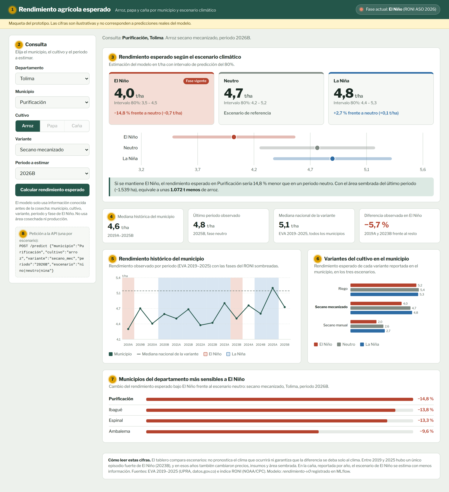

# Maqueta (mockup) del tablero

Archivo interactivo: [`tablero_mockup.html`](tablero_mockup.html). Se abre directamente en el navegador, sin servidor ni dependencias. Al agregar `#anotada` al final de la URL se muestran los números de referencia de la tabla de abajo.

> Todas las cifras de la maqueta son **ilustrativas**. Solo las medianas nacionales por variante provienen de los datos (Tabla 5 del reporte, `src/eda_eva.py`). Los valores por municipio y los efectos por escenario son ficticios y sirven para mostrar la forma de la respuesta que entregará la API.



## Usuario y flujo

El usuario principal es un analista de una secretaría de agricultura departamental (usuarios secundarios: gremios y aseguradoras agrícolas). El flujo es:

1. Selecciona departamento, municipio, cultivo, variante y periodo a estimar.
2. El tablero hace tres llamadas a la API `POST /predict`, una por escenario (El Niño, neutro y La Niña), con el mismo municipio, cultivo, variante y periodo.
3. El tablero muestra las tres estimaciones lado a lado y resalta la fase vigente según el último trimestre del RONI.
4. Debajo, el contexto histórico y comparativo ayuda a interpretar la estimación.

## Elementos y relación con la pregunta de negocio

**Pregunta de negocio:** ¿cuál es el rendimiento esperado (t/ha) de arroz, papa y caña en un municipio y periodo dados, y cuánto difiere esa estimación bajo El Niño frente a un escenario neutro o de La Niña?

| # | Elemento | Tipo | Qué responde |
|---|----------|------|--------------|
| 1 | Encabezado con fase actual del RONI | Contexto | Indica qué escenario es el vigente hoy (El Niño, declarado por el IDEAM en 2026). |
| 2 | Panel de consulta | Entrada | Define la combinación municipio × cultivo × variante × periodo. Solo usa variables conocidas antes de la cosecha. |
| 3 | Tarjetas y gráfica de escenarios | **Predictivo** | Responde directamente la pregunta de negocio: rendimiento esperado por escenario, intervalo de predicción del 80% y diferencia frente al neutro en % y t/ha. El mensaje inferior lo traduce a toneladas con el área sembrada del último periodo. |
| 4 | Indicadores de contexto | Descriptivo | Mediana histórica del municipio, último periodo observado, mediana nacional de la variante y diferencia observada en los periodos de El Niño. Permiten juzgar si la estimación es razonable. |
| 5 | Histórico del municipio con fases RONI | Descriptivo | Pregunta de apoyo 1 y 2: evolución 2019–2025 y comportamiento en El Niño 2019A y 2023B frente al resto. |
| 6 | Comparación de variantes | Predictivo | Pregunta de apoyo 3: ¿responde distinto el arroz de riego frente al de secano, la papa criolla frente a las demás, la caña de azúcar frente a la panelera? |
| 7 | Ranking departamental de sensibilidad | Predictivo | Pregunta de apoyo 4: ¿en qué municipios el rendimiento es más sensible a El Niño? Ayuda a priorizar apoyos dentro del departamento. |
| 8 | Petición a la API | Trazabilidad | Muestra el contrato de entrada de la API que consumirá el tablero en la Entrega 2. |
| — | Nota de lectura | Limitaciones | Advierte que se comparan escenarios, no se pronostica el clima, y que solo hubo un episodio fuerte de El Niño en 2019–2025. |

## Contrato previsto de la API

```json
POST /predict
{
  "municipio": "Purificación",
  "cultivo": "arroz",
  "variante": "secano_mec",
  "periodo": "2026B",
  "escenario": "nino"
}

200 OK
{
  "rendimiento_t_ha": 4.0,
  "intervalo_80": [3.5, 4.5],
  "modelo": "rendimiento-v0"
}
```

## Decisiones de diseño a partir de la exploración

- **Escenarios en paralelo y no un solo selector de escenario.** La pregunta de negocio es una comparación, así que las tres estimaciones se muestran juntas en lugar de obligar al usuario a cambiar el escenario y recordar el valor anterior (cambio frente a la versión inicial de la maqueta).
- **Intervalos de predicción visibles.** Con solo dos semestres de El Niño (2019A y 2023B) la incertidumbre de ese escenario es mayor; el intervalo de El Niño se dibuja más ancho, y aún más en caña, donde ningún año completo alcanza el umbral.
- **Variante siempre explícita.** La exploración mostró diferencias de nivel grandes entre variantes (p. ej. caña de azúcar 113 t/ha frente a panelera 50 t/ha), por lo que la variante es un filtro obligatorio y se compara en un panel propio.
- **Periodo según el cultivo.** Arroz y papa se consultan por semestre (2026B) y caña por año (2026), igual que en EVA.
- **Sin área cosechada ni producción como entrada**, porque solo se conocen después de la cosecha.
- **Opciones limitadas a lo reportado.** El cultivo y la variante solo se pueden elegir si el municipio los reporta en EVA.
