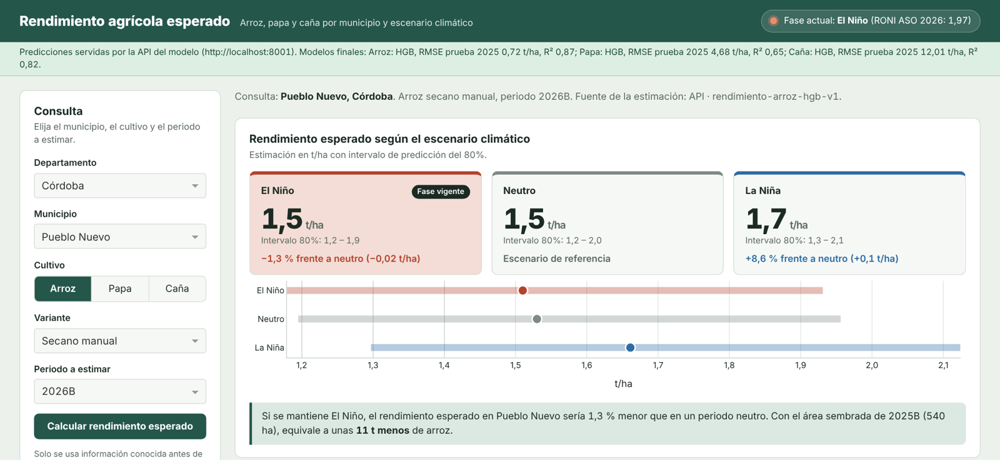
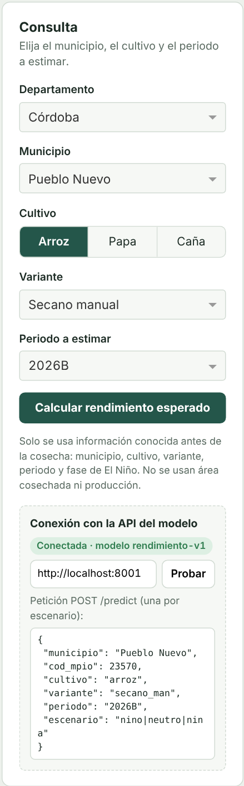
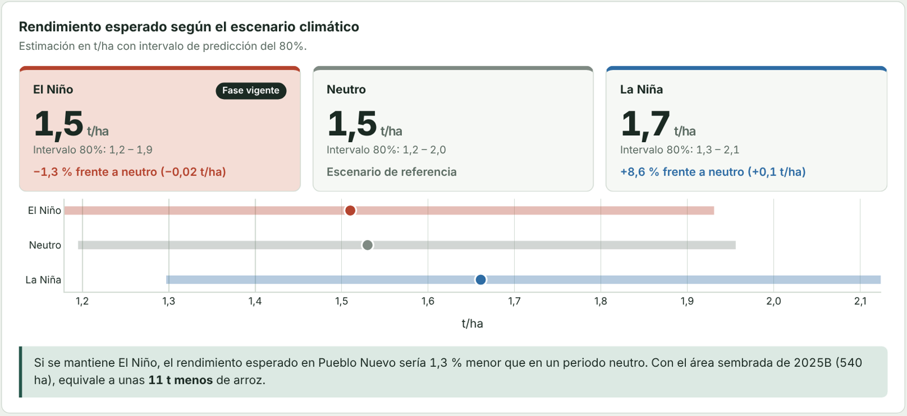
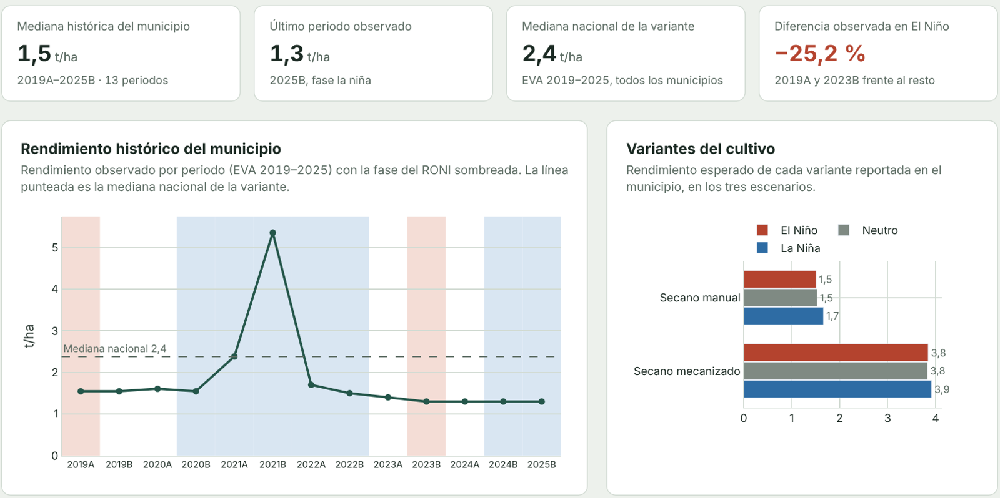
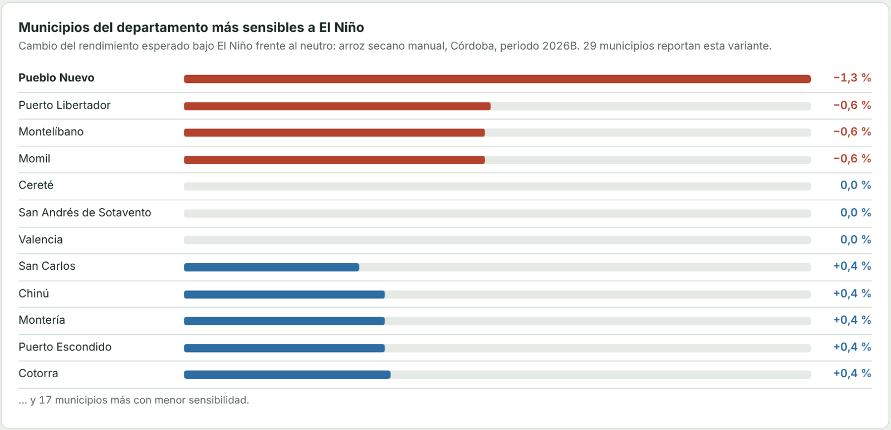
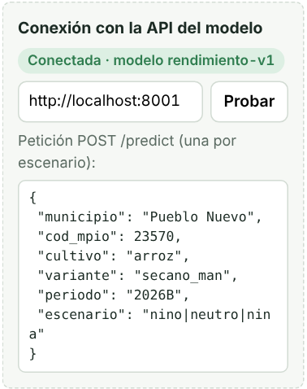
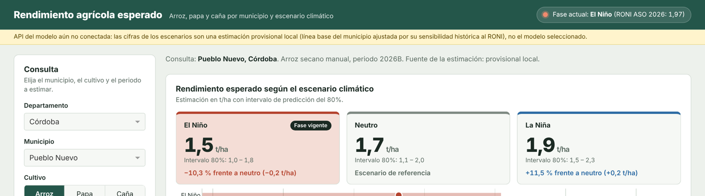

# Manual de usuario del tablero

**Rendimiento agrícola esperado: arroz, papa y caña por municipio y escenario climático**

## 1. ¿Para qué sirve?

El tablero está pensado para las secretarías de agricultura departamentales. Para un municipio, un cultivo, una variante y un periodo, muestra el **rendimiento esperado (t/ha)** en tres escenarios climáticos: **El Niño**, **neutro** y **La Niña**. También muestra cuánto cambia el rendimiento frente al escenario neutro.

Las cifras salen del modelo final de cada cultivo (HistGradientBoosting), que la API sirve a partir de las EVA 2019–2025 (UPRA) y el índice RONI (NOAA/CPC).

El tablero **no pronostica si habrá El Niño**. Compara qué rendimiento esperar si se presenta cada fase. La fase vigente aparece en la esquina superior derecha, calculada con el último trimestre publicado del RONI.

## 2. Acceso

Abra en el navegador la dirección del tablero:

- Desplegado en EC2: `http://<IP-PUBLICA>:8050`
- En un computador local: `http://localhost:8050`

No necesita usuario ni contraseña. Para instalarlo, consulte el [manual de instalación](manual_instalacion.md).

La pantalla tiene cuatro zonas:

1. **Encabezado:** título y fase actual del RONI. Por ejemplo, *Fase actual: El Niño (RONI ASO 2026: 1,97)*.
2. **Franja de estado:** indica de dónde salen las cifras (ver sección 7).
3. **Panel de consulta** (izquierda): filtros y conexión con la API.
4. **Resultados** (derecha): escenarios, indicadores, gráficas y ranking.

## 3. Hacer una consulta

1. **Departamento:** elija el departamento. Puede escribir para buscarlo.
2. **Municipio:** la lista muestra solo los municipios del departamento elegido.
3. **Cultivo:** *Arroz*, *Papa* o *Caña*. Solo se activan los cultivos que el municipio reporta en las EVA.
4. **Variante:** depende del cultivo.
   - Arroz: riego, secano mecanizado o secano manual.
   - Papa: papa (todas menos criolla) o papa criolla.
   - Caña: caña de azúcar o caña panelera.
5. **Periodo a estimar:** semestral en arroz y papa (por ejemplo, `2026B` o `2027A`) y anual en caña (`2026`, `2027`).
6. Haga clic en **Calcular rendimiento esperado**. Los resultados se actualizan solos al cambiar la variante o el periodo. Después de cambiar el municipio o el cultivo, vuelva a hacer clic en el botón para asegurarse de ver la consulta nueva.

El tablero usa solo información que se conoce antes de la cosecha: municipio, cultivo, variante, periodo y fase de El Niño. No usa el área cosechada ni la producción.

## 4. Leer los escenarios

- **Tres tarjetas** (El Niño, Neutro y La Niña). Cada una trae:
  - El **rendimiento esperado** en t/ha (número grande).
  - El **intervalo del 80 %**: en 8 de cada 10 casos, el rendimiento real debería quedar dentro de ese rango. Se calcula con los errores del modelo en validación para cada variante.
  - La **diferencia frente al neutro**, en % y en t/ha. Rojo indica una caída y azul un aumento. Si la diferencia es menor a 0,5 %, la tarjeta dice *Sin diferencia apreciable frente a neutro*.
- **Etiqueta "Fase vigente":** marca el escenario que coincide con la fase actual del RONI.
- **Gráfica de intervalos:** el punto es el rendimiento esperado y la barra es el intervalo del 80 %. Si las barras se traslapan mucho, la diferencia entre escenarios es pequeña frente a la incertidumbre del modelo.
- **Mensaje inferior:** traduce la diferencia de El Niño a toneladas, con el área sembrada del último periodo observado. En el ejemplo: 1,3 % menos, unas 11 t menos de arroz en 540 ha.

## 5. Contexto del municipio y variantes

**Indicadores observados** (no son estimaciones del modelo):

| Indicador | Qué muestra |
|---|---|
| Mediana histórica del municipio | Rendimiento típico 2019–2025 en esa variante. |
| Último periodo observado | Rendimiento del último periodo reportado y la fase del RONI en ese momento. |
| Mediana nacional de la variante | Referencia de todos los municipios del país. |
| Diferencia observada en El Niño | Cuánto difirió el rendimiento en periodos El Niño frente al resto. Dice *Sin dato* cuando no hubo periodos El Niño (caña). |

- **Rendimiento histórico del municipio:** serie 2019–2025 con las fases del RONI sombreadas (rojo: El Niño; azul: La Niña) y la mediana nacional como línea punteada.
- **Variantes del cultivo:** compara los tres escenarios para cada variante que el municipio reporta.

## 6. Ranking del departamento

Ordena los municipios del departamento que reportan la variante elegida según el cambio estimado bajo El Niño frente al neutro. Los primeros son los más afectados. El municipio consultado aparece en negrilla. Sirve para priorizar dónde enfocar medidas de apoyo.

## 7. Estado de la conexión con la API

El recuadro *Conexión con la API del modelo* muestra:

- El estado: **Conectada · modelo rendimiento-v1**, o **No conectada** con el motivo.
- La dirección de la API. Se puede cambiar y comprobar con **Probar**.
- La petición JSON que el tablero envía a `POST /predict`.

La **franja bajo el encabezado** indica de dónde salen las cifras:

| Color | Significado |
|---|---|
| **Verde** | *Predicciones servidas por la API del modelo.* Las cifras son las del modelo final. La franja también muestra su RMSE y R² en la prueba de 2025. |
| **Amarilla** | *API del modelo aún no conectada.* Las cifras son una **estimación provisional local**, que no corresponde al modelo seleccionado. No las use para tomar decisiones; avise al administrador. |

Si la franja está amarilla, haga clic en **Probar**. Si sigue igual, la API está apagada (ver la sección *Solución de problemas* del manual de instalación).

## 8. Cómo interpretar los resultados

- El tablero **compara escenarios**. No garantiza que la diferencia se deba solo al clima.
- Entre 2019 y 2025 solo hubo dos semestres de El Niño (2019A y 2023B) y ningún año completo en esa fase. Por eso las diferencias que estima el modelo son pequeñas: el histórico del municipio explica la mayor parte del rendimiento. En caña, el escenario de El Niño se estima con aún menos información.
- Las diferencias observadas en el pasado (indicador *Diferencia observada en El Niño*) pueden ser mayores que las estimadas, porque incluyen otros factores de esos periodos.
- Interprete el RMSE dentro de cada cultivo. En la prueba de 2025 fue de 0,72 t/ha en arroz, 4,68 t/ha en papa y 12,01 t/ha en caña.

## 9. Preguntas frecuentes

**No aparece un cultivo o una variante.** El municipio no los reporta en las EVA 2019–2025.

**¿Por qué caña usa años y no semestres?** Las EVA reportan la caña de forma anual, por su ciclo largo.

**¿Puedo estimar periodos pasados?** No. El tablero ofrece los periodos siguientes al último observado (2026B y 2027A en arroz y papa; 2026 y 2027 en caña).

**¿Qué significa el intervalo del 80 %?** Es el rango donde debería quedar el rendimiento real en 8 de cada 10 casos, según los errores del modelo en 2024.
